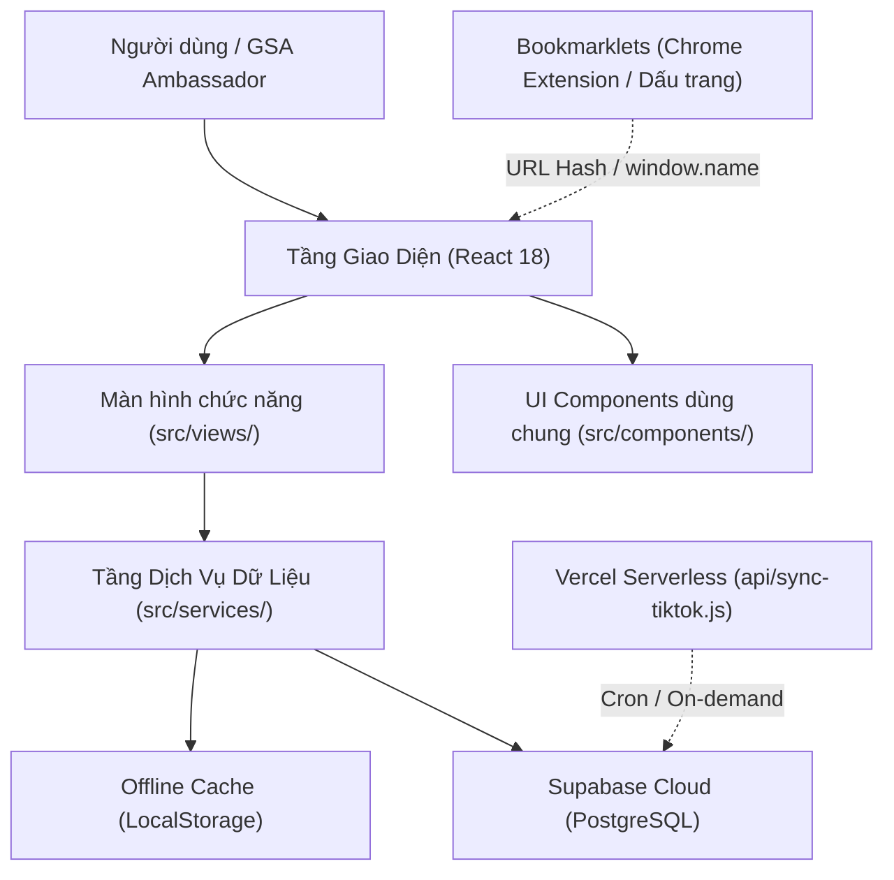

# Kiến Trúc Hệ Thống - Creator Studio Dashboard (WEBTVY)

Tài liệu này mô tả chi tiết kiến trúc phân tầng, luồng dữ liệu (Data Flow) và cơ chế lưu trữ của ứng dụng.

---

## 1. Mô Hình Phân Tầng

Ứng dụng được thiết kế theo mô hình **Separation of Concerns (SoC)** phân tách rõ ràng giữa 3 tầng:

---

## 2. Luồng Dữ Liệu Đồng Bộ Đa Nguồn (Multi-Source Data Flow)

### A. Lịch Nội Dung (`gsa_contents`)
1. Khi ứng dụng khởi chạy, `contentService` đọc ngay dữ liệu từ LocalStorage để hiển thị tức thì (zero-delay).
2. Song song đó, `contentService.syncWithSupabase()` thực hiện truy vấn bảng `gsa_contents` trên Supabase:
   - Nếu có dữ liệu mới trên cloud: Cập nhật state và ghi đè vào cache LocalStorage.
   - Nếu offline hoặc lỗi mạng: Giữ nguyên dữ liệu LocalStorage để đảm bảo trải nghiệm không bị gián đoạn.

### B. Đồng Bộ Chỉ Số Mạng Xã Hội (`social_metrics`)
1. Người dùng truy cập trang cá nhân TikTok hoặc Facebook trên Chrome.
2. Nhấn nút Bookmarklet tương ứng trên thanh dấu trang.
3. Bookmarklet duyệt cây DOM thực tế, trích xuất mã bài viết, tiêu đề, số lượt xem, tim, bình luận và chia sẻ.
4. Hiển thị Modal xem trước (Preview Modal) để người dùng kiểm tra số liệu.
5. Khi bấm **"Chuyển về Studio"**:
   - Dữ liệu được mã hóa JSON và đính kèm vào URL hash `#sync_payload=...`.
   - Mở tab ứng dụng `https://web-c-a-tvy.vercel.app`.
   - `src/App.jsx` bắt payload và thực hiện `supabase.from('social_metrics').upsert(...)`.

---

## 3. Quản Lý Trạng Thái (State Management)

- **Root State (`src/App.jsx`):** Quản lý tab hiện tại (`currentTab`), danh sách bài viết (`contents`), thống kê tổng quát (`stats`), và các modal toàn cục.
- **View-Level State:** Mỗi View trong `src/views/` tự quản lý state hiển thị cục bộ (chế độ xem biểu đồ, bộ lọc, từ khóa tìm kiếm).
- **Service-Level Singletons:** Các đối tượng `contentService`, `metricsService`, `ideaService`, `checklistService` xuất phát từ các service class/module độc lập, cho phép tái sử dụng ở bất kỳ component nào mà không phải truyền props qua nhiều tầng.
